# Mimo

[Сайт](https://dokmoshen.github.io/mimo/) · [Исходники](https://github.com/dokmoshen/mimo) · [Releases](https://github.com/dokmoshen/mimo/releases) · GPL-3.0

**Mimo** — локальные заметки для Android 17 с дизайном **Material 3 Expressive** и собственной «плавающей» системой навигации: компактный нижний док, который плавно перестраивается в панель меню или быстрого захвата, и нижние листы. В шапке — только логотип и строка поиска; при нажатии поиск плавно раскрывается на весь экран и заменяет заметки результатами. При прокрутке вниз поиск скрывается, а логотип перемещается в центр; при прокрутке вверх поиск возвращается. Шапка и системная строка статуса прозрачные — заметки проходят под логотипом и под часами/батареей. Сверху и снизу — мягкие градиентные фоги: карточки плавно растворяются в фоне, не оставляя резких стыков под шапкой и над доком. Карточки подстраиваются под содержимое: фото становится обложкой, чек-лист показывает кольцо прогресса, а заголовок укрупняется. Заметка открывается в спокойном режиме чтения, редактор вызывается карандашом или нижней кнопкой. По набору сценариев приложение повторяет основной функционал Google Keep, но выглядит иначе: тёплая бумажная палитра, 12 пастельных цветов заметок, крупная типографика Unbounded + Manrope, органические формы и пружинные анимации.

| Светлая тема | Тёмная тема | Быстрая заметка |
|---|---|---|
| 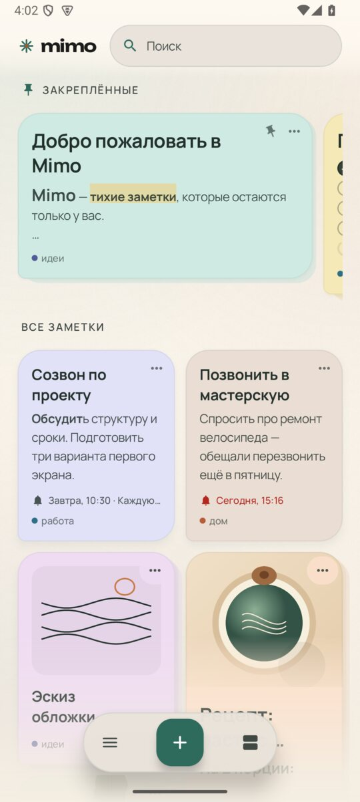 | 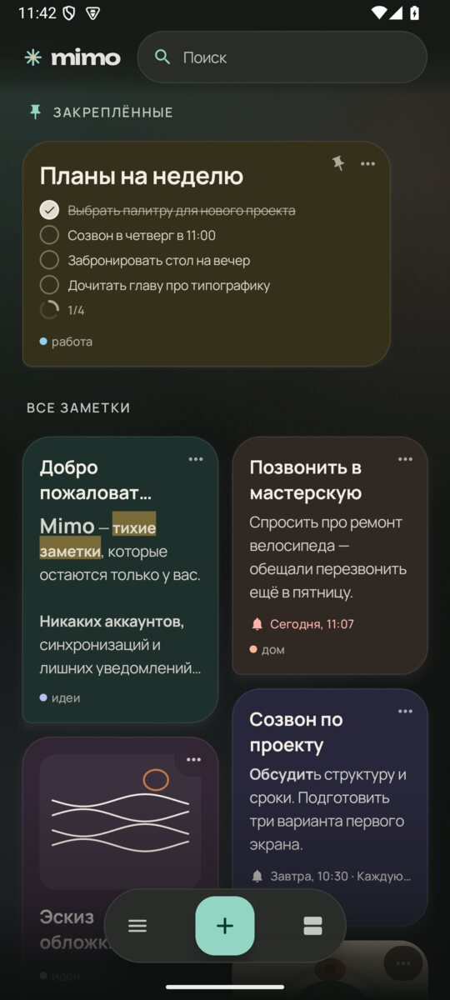 | 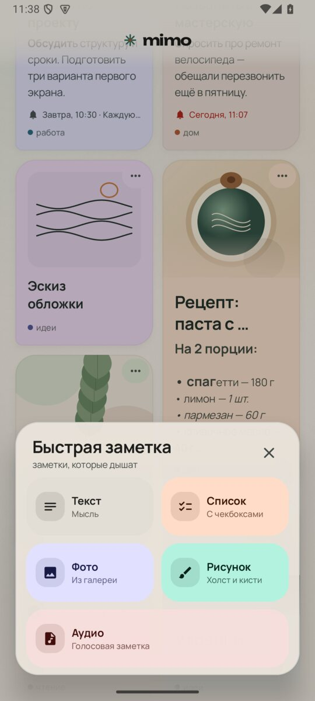 |

| Режим чтения | Напоминания | Метки |
|---|---|---|
| 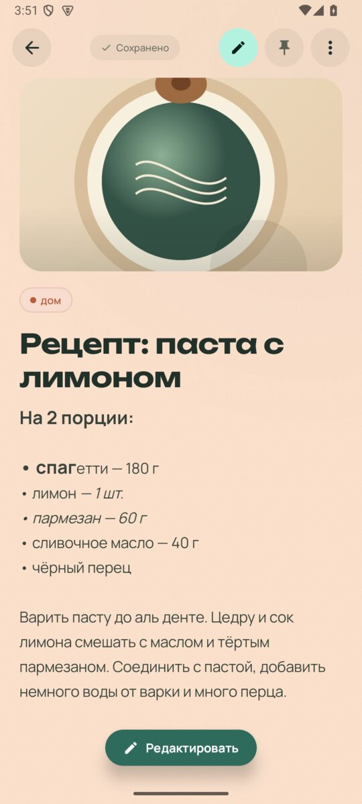 | 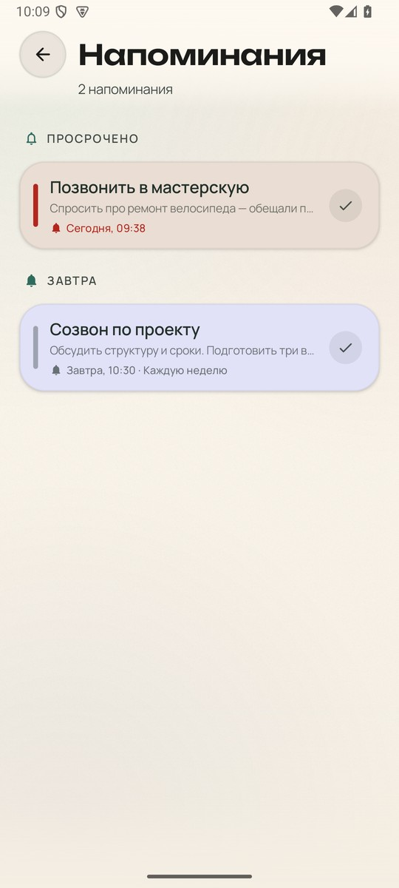 | 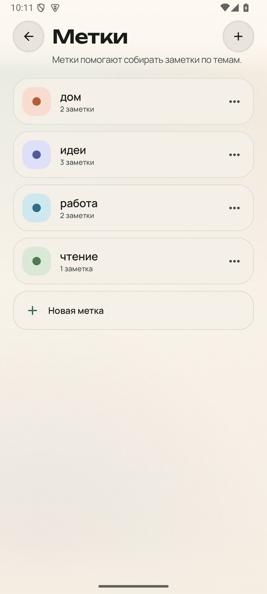 |

| Меню | Настройки | Поиск |
|---|---|---|
| 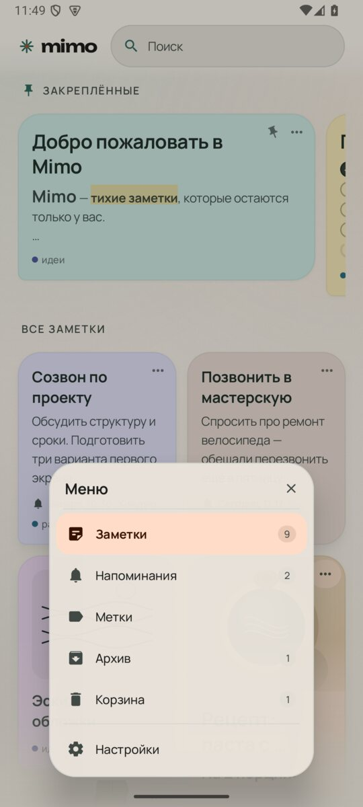 | 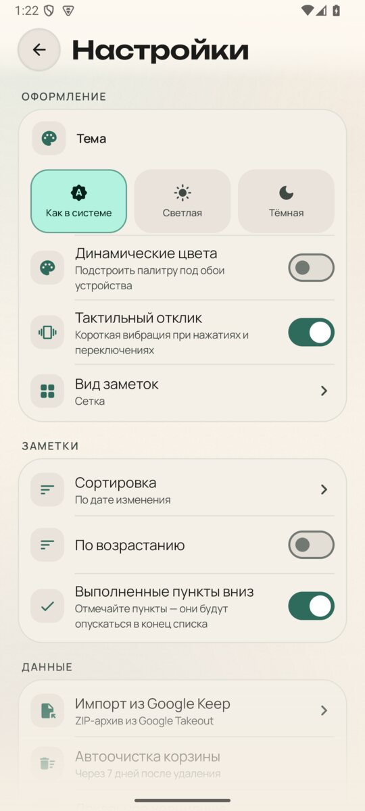 | 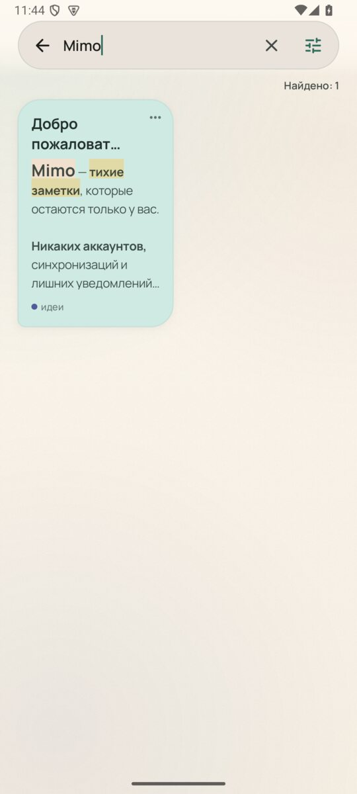 |

Свёрнутая при прокрутке шапка:

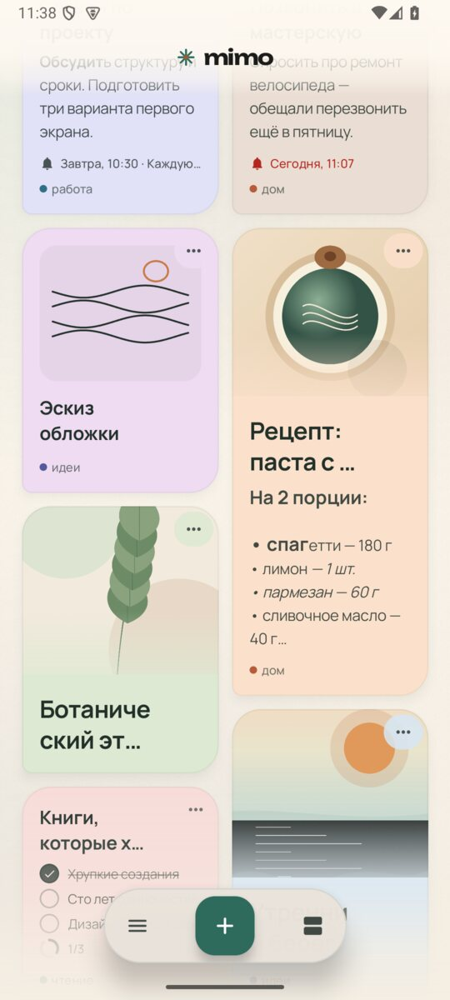

Первый запуск: спокойный экран знакомства с приложением, создание заметки и импорт из Keep.

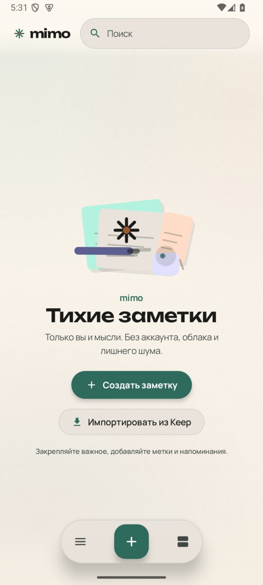

Стартовый экран поиска:

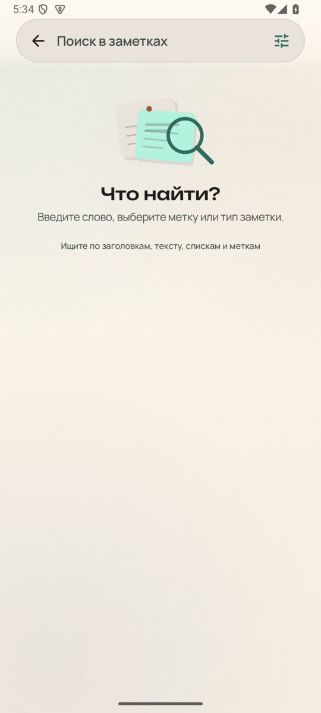

Пустые состояния с рисованными сценами:

| Архив | Метки |
|---|---|
| 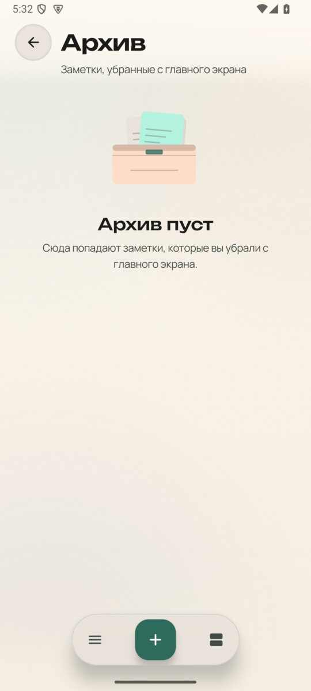 | 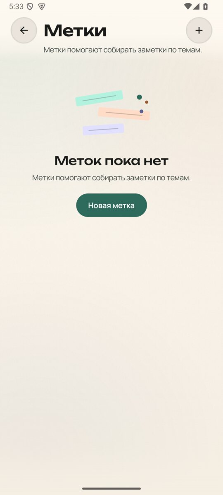 |

## Возможности

### Заметки

- Текстовые заметки с **rich-text**: жирный, курсив, подчёркивание, зачёркивание, выделение, заголовки, маркированные и нумерованные списки.
- **Undo/redo** для rich-text.
- **Проверка текста**: безопасные локальные правила, компактная ONNX-модель русской пунктуации (RUPunct_small, 29 МБ) и встроенный словарь орфографии. Всё работает на устройстве, без сети и Google-сервисов. Перед применением показывается diff «Было / Стало» с подсветкой ошибок, слов и пропусков; rich-text-форматирование сохраняется.
- Чек-листы с пунктами, вложенностью, автоматическим переносом выполненных вниз и перестановкой пунктов.
- **Фото** из галереи (Photo Picker) и с камеры; изображения хранятся в приватном хранилище приложения.
- **Рисунки** от руки: ластик, толщина кисти, палитра, undo/redo, очистка; рисунок можно переоткрыть и продолжить.
- **Аудиозаметки**: запись, пауза, продолжение, воспроизведение, удаление и перезапись.
- Закрепление заметок, 12 цветов, метки, создание копии, отправка текста, удаление с отменой.
- **Блокировка заметки** по биометрии, блокировке экрана или PIN-коду; содержимое скрывается в списках, поиске и уведомлениях. Для заблокированной заметки включается `FLAG_SECURE` — скриншоты и превью в списке недавних приложений недоступны.
- **Режим чтения**: существующая заметка открывается как аккуратная страница с крупной фото-обложкой, заголовком, rich-text, чек-листом, рисунком, фото и аудио; обложка, заголовок и текст появляются каскадом. Редактирование — по карандашу в шапке или нижней кнопке «Редактировать»; новая заметка сразу открывается в редакторе.
- Автосохранение каждого изменения; простой просмотр не меняет дату изменения и не переставляет заметки.
- Редактор в стиле «бумаги»: фон меняется вместе с цветом заметки, плавающие верхняя панель и нижний тулбар.

### Организация

- Сетка и список, сортировка по дате изменения, создания или заголовку; сортировка по возрастанию.
- Отдельная секция «Закреплённые» в виде горизонтальной полки в grid-режиме.
- **Метки** с цветами, счётчиками и управлением из отдельного экрана.
- **Поиск** по заголовку, тексту, пунктам списков и меткам; компактная строка поиска в шапке плавно раскрывается на весь экран и заменяет заметки результатами. Совпадения подсвечиваются в заголовке и тексте с мягкой анимацией, результаты появляются со стаггером, закреплённые идут отдельной секцией, а недавние запросы сохраняются в памяти и доступны на стартовом экране поиска. Фильтры по типу, цвету, меткам, наличию напоминания и фото, включая архив.
- Мультивыделение долгим нажатием: закрепить, покрасить, назначить метки, отправить в архив/корзину, удалить, копировать, отправить.
- Архив и **корзина с автоочисткой через 7 дней**.
- «Все заметки / Напоминания / Метки / Архив / Корзина / Настройки» во всплывающем меню над доком.
- **Импорт из Google Keep**: перенос заметок, списков, меток, цветов, закрепления, архива, корзины, фото и аудио из ZIP-архива Google Takeout.

### Импорт из Google Keep

1. Экспортируйте данные через [Google Takeout](https://takeout.google.com/) и выберите только **Keep**.
2. Скачайте ZIP-архив.
3. В Mimo откройте **Настройки → Данные → Импорт из Google Keep** и выберите архив.
4. Импорт выполняется полностью на устройстве. Современные архивы читаются из JSON, старые — из HTML.

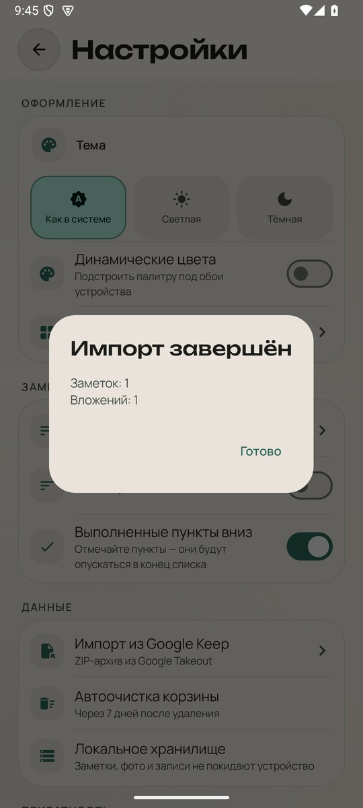

Импортируются текст, чек-листы, метки, цвета, закрепление, архив, корзина, изображения и аудио. Напоминания, блокировки, участники и вложения неподдерживаемых форматов пока не переносятся. Повторный импорт создаёт копии заметок.

### Напоминания

- Дата и время с Material 3 DatePicker/TimePicker (русская локаль).
- Повторы: ежедневно, еженедельно, ежемесячно, ежегодно.
- Уведомления с действиями **«Отложить на час»** и **«Выполнено»**; переход по уведомлению сразу открывает заметку.
- Перепланирование после перезагрузки устройства.
- Разрешение «Точные напоминания» открывается из настроек; без него используется системное неточное планирование.

### Блокировка заметок

- Кнопка блокировки доступна в верхней панели редактора и в меню заметки.
- На устройствах с биометрией используется системное подтверждение; PIN предлагается как запасной вариант прямо в окне биометрии.
- В **Настройки → Безопасность → PIN-код для заметок** можно задать четыре цифры. Если биометрия недоступна, PIN используется как основной способ входа.
- Для заблокированных заметок включается защита от скриншотов и превью в списке недавних приложений.
- PIN хранится локально в виде хеша с солью; содержимое заметок не шифруется.

### Оформление и настройки

- Светлая/тёмная/системная тема, динамические цвета Android 12+.
- **Тактильный отклик**: лёгкие тики на карточки, кнопки, чипы, переключатели, чек-листы, ползунки и действия редактора; для подтверждений, удалений и переключений используются разные типы вибрации. Отключается в **Настройки → Оформление → Тактильный отклик**.
- Сетка/список, сортировка, поведение выполненных пунктов.
- **Контентные карточки**: фото-обложка на всю ширину, счётчик фотографий, кольцо прогресса чек-листа, крупный заголовок для заметок с изображениями и цветные тени.
- **Брендовый первый запуск**: анимированная звёздочка, спокойный экран знакомства, создание заметки и импорт из Keep; собственные рисованные сцены в пустых состояниях.
- **Живой знак Mimo**: лучи звёздочки рисуются по очереди, знак мягко «дышит» на приветственном экране и загрузке, а в статусе сохранения стоит его миниатюра.
- Компактный плавающий нижний док с центральной кнопкой и морфингом иконки.
- Меню и быстрый захват: весь плавающий док перестраивается в панель меню или панель создания заметки и складывается обратно. Контейнер пружинисто меняет ширину, высоту и скругления, внутри появляется мягкий цветной прилив, пункты меню всплывают каскадом, контент обрезается по форме панели, а кнопки дока остаются внутри неё и возвращаются вместе с панелью; фон мягко затемняется.
- Шапка главного экрана: логотип слева, сжатая строка поиска справа, без дублирующей кнопки меню.
- **Единый прозрачный верхний бар** на всех вторичных экранах: «Назад» + крупный заголовок, без `mimo`, контент уходит под мягкий фог.
- **Контейнерный переход** «карточка → редактор»: заметка раскрывается в полноэкранный лист и складывается обратно.
- **Бумажная фактура** с мягким зерном, цветные тени карточек и выразительные фото-коллажи в редакторе.
- **Глубина фото-обложек**: мягкая виньетка, верхний градиент и параллакс при драге и прокрутке читалки.
- **Стопка бумаги**: карточки с вложениями показывают 1–2 смещённых листа за собой, а выбранная карточка приподнимается над остальными.
- **Чернильный чек-лист**: отметка пункта оставляет чернильный штамп, а завершённый список получает печать вместо кольца прогресса.
- **Микроанимации**: press-scale, пружинные чекбоксы, поворот закрепления, «расцветание» цветовых свотчей и вылет карточек в архив/корзину.
- **Живые переходы**: predictive back в редакторе, зум фото-обложки и shared-переход в полноэкранный просмотр, «дыхание» заголовка при прокрутке читалки, sweep-подсветка поиска и обратный каскад liquid-дока.
- **Expressive-меню**: узкие скруглённые группы с разделителями, блюром фона самой панели и цветовым акцентом опасных действий; фон приложения остаётся резким.
- **Чтение ↔ редактирование**: в шапке редактора есть книжная кнопка, которая возвращает в режим чтения без выхода из заметки.
- **Эластичные жесты**: потяните карточку в сторону или плавающую панель в любом направлении — объект сразу следует за пальцем, слегка растягивается и пружинисто возвращается. Для карточек горизонтальное движение включает растяжение, а вертикальное остаётся прокруткой; панель в доке тянется в любом направлении. Долгое нажатие без движения по-прежнему выделяет заметку.
- **Focus mode** в редакторе: при прокрутке верхняя и нижняя панели прячутся, оставляя только текст.
- **Waveform** для аудио с прокруткой по тапу вместо плоского прогресс-бара.
- Material Shapes, expressive motion, edge-to-edge, предсказуемый back.
- Иконка приложения, splash screen, ярлыки быстрых действий (заметка / список / поиск).
- Полностью офлайн: в манифесте нет разрешения `INTERNET`. Модель пунктуации и словарь орфографии лежат внутри APK и не обращаются к сети.
- Шрифты **Manrope** и **Unbounded** по лицензии SIL OFL (файлы лицензий лежат в `app/src/main/assets/licenses`).

## Технологии

- Kotlin 2.4.21, Jetpack Compose, Compose BOM `2026.11.01`, Material 3 `1.5.0`.
- ONNX Runtime Android `1.22.0`; модель RUPunct_small INT8 (`29 МБ`, MIT) и локальный словарь русских слов.
- AGP `9.5.2`, Gradle `9.6.0`, JDK 21.
- `compileSdk 37.1`, `targetSdk 37` (Android 17), `minSdk 26`.
- Room 2.8.5, DataStore Preferences, Navigation — собственная лёгкая навигация.
- jsoup для разбора HTML-экспорта Google Keep, ZIP — стандартными средствами Java.
- AlarmManager + BroadcastReceiver для напоминаний, BiometricPrompt для блокировки заметок.
- Без сети, DI-фреймворков и Compose-навигации: только platform API и AndroidX.

## Структура проекта

```
app/src/main/java/app/mimo/notes/
├── data/                 Room, репозиторий, JSON-кодеки, вложения
├── notifications/        AlarmManager, каналы и приёмники уведомлений
├── preferences/          DataStore-настройки
├── demo/                 Debug-наполнение (не запускается в release)
├── importer/             импорт Google Keep: JSON, HTML, ZIP и вложения
├── util/                 BiometricPrompt-обёртка
└── ui/
    ├── theme/            Expressive-тема, палитры, типографика
    ├── components/       карточки, док, панель, листы, логотип
    ├── notes/            главный экран, сетка, мультивыделение, inline-поиск
    ├── editor/           редактор, чек-листы, рисование, аудио
    ├── search/           фильтры поиска
    ├── reminders/        экран напоминаний
    ├── labels/           управление метками
    └── settings/         настройки
```

## Проверено

- `assembleRelease` с R8 и `lintVitalRelease` — успешно.
- 44 JVM-теста: rich-text форматирование, JSON-кодеки, сортировка, поиск, правила и diff проверки текста, WordPiece-токенизатор, русский словарь и парсер импорта Google Keep.
- Release-сборка устанавливается начисто без демо-заметок: при первом запуске показывается брендовый экран знакомства.
- Приложение запускается на **Android 17 (API 37)** (AOSP ATD) и на Android 15; визуальные скриншоты сняты на Android 15 из-за нестабильного системного композитора эмулятора хоста.

## Лицензия

Исходный код Mimo распространяется по **GNU General Public License v3.0**. Полный текст — в [`LICENSE`](LICENSE), дополнительные оговорки — в [`NOTICE`](NOTICE).

- Код можно использовать, изменять и распространять по условиям GPL-3.0.
- Производные версии при распространении должны оставаться под GPL-3.0 и сопровождаться исходным кодом.
- Название Mimo, логотип, иконка и фирменный стиль не лицензируются как бренд-ресурсы.
- Шрифты Manrope и Unbounded распространяются отдельно по SIL Open Font License 1.1.

## Ограничения

Это локальное приложение, поэтому намеренно отсутствуют функции, требующие сервера или сервисов Google:

- синхронизация с аккаунтом и совместное редактирование;
- геолокационные напоминания;
- распознавание текста на фото и транскрибация аудио;
- виджет домашнего экрана.

Блокировка заметки — UI-уровень (биометрия, экранный замок или PIN), а не шифрование базы: данные лежат в приватном хранилище приложения, но системный backup может включать базу. PIN хранится как salted SHA-256 хеш.
